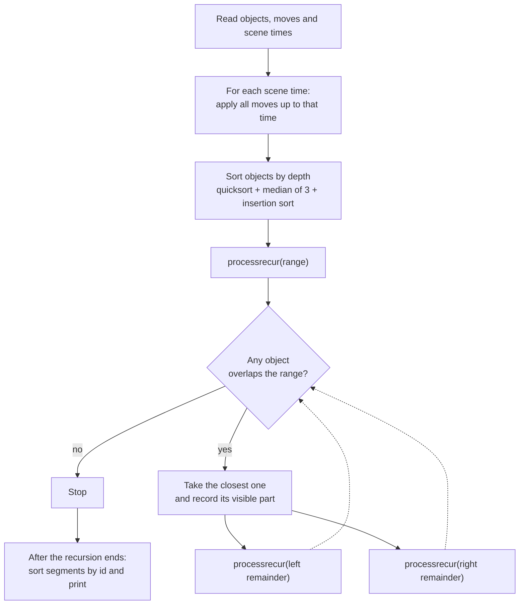

# Occluded Object Identifier

**English** | [Português](README.pt-BR.md)


A C++ implementation of **occlusion culling for 2D scenes**: given a set of objects at different depths that move over time, it computes which parts of each object are actually visible to the viewer, discarding everything hidden behind closer objects.

Developed for the Data Structures course (Systems Engineering, Universidade Federal de Minas Gerais, 2025). The full report (in Portuguese), with the complexity analysis and experiments, is in [`docs/relatorio_tp1.pdf`](docs/relatorio_tp1.pdf).

---

## Highlights

- **Custom abstract data types** (`Obj`, `Obj_List`, `Segment`, `Scene`, `interval`, `Move`) built from scratch, without the STL containers, including dynamic arrays with amortized doubling.
- **Recursive divide-and-conquer occlusion.** The algorithm finds the closest object in a range, keeps its visible part and solves the left and right remainders recursively.
- **Hand-written sorting.** Quicksort with median-of-three pivot that switches to insertion sort for small partitions (n ≤ 10), plus binary search and interval merging.
- **Complexity analysis** of every procedure, with recurrences: O(n log n) for sorting and O(n²) worst case for scene generation.
- **Experimental study** of when to re-sort a moving scene. Allowing 20–40% disorder before re-sorting cut total cost by more than 80% compared with sorting after every move.

## The problem

Each object is a horizontal segment with a center `x`, a width and a depth `y` (smaller `y` means closer to the viewer). Objects move over time, and at given instants the program must output the visible part of each object. A part of an object is hidden whenever a closer object covers the same horizontal range.

```
 viewer
   │
   ▼        ┌───── 1 (y=1) ─────┐
 y=1        0                   4
 y=2                  ┌────── 2 (y=2) ──────┐          → visible: [4, 7]
                      3                     7
 y=3                                            ┌─ 3 ─┐  → visible: [8, 10]
                                                8     10
```

## How it works



The closest object in a range is visible across its whole overlap with that range, because nothing is in front of it there. Everything else in that overlap is hidden, so the problem only continues to the left and right of it. Floating-point comparisons use a 1e-12 tolerance.

| Procedure | Time | Space |
|---|---|---|
| Binary search on intervals (`bisearch`) | O(log n) | O(1) |
| Quicksort with median of 3 | O(n log n) average | O(log n) |
| Visible parts of an object (`getvisible`) | O(n log n) | O(n) |
| Recursive occlusion (`processrecur`) | O(n²) worst case | O(n) |
| Full scene (`hiddenscene`) | O(n²) | O(n) |

## Experimental results

The report measures a trade-off for moving scenes: re-sorting the objects after every move keeps scene generation cheap but is expensive by itself, while letting the order degrade saves sorting time but slows scene generation. The experiment varied the number of objects (200 to 10,000), the speed of movement and a disorder threshold T that triggers a re-sort, averaging 10 runs per configuration.

| Strategy (N = 5,000, speed 10) | Total cost |
|---|---|
| Always sort (T = 0%) | 62.6 ms |
| Threshold T = 40% | 9.6 ms |

- Thresholds between 20% and 40% reduced the total cost by more than 80% compared with always sorting.
- Scene generation stayed below 1 ms until disorder exceeded about 20%.
- With 10,000 objects, always sorting cost about 124 ms against about 54 ms with T = 20%.

## Input and output

The program reads from standard input:

| Line | Meaning |
|---|---|
| `O <id> <x> <y> <width>` | object centered at `x`, at depth `y` |
| `M <time> <id> <x> <y>` | at `time`, object `id` moves to (`x`, `y`) |
| `C <time>` | output the scene at `time` |

For each scene it prints `S <time> <id> <start> <end>` for every visible segment, sorted by object id. Example ([`examples/01_movimento.in`](examples/01_movimento.in)):

```
O 1 2.0 1.0 4.0        S 0 1 0.00 4.00
O 2 5.0 2.0 4.0        S 0 2 4.00 7.00
O 3 9.0 3.0 2.0        S 0 3 8.00 10.00
C 0                    S 1 1 4.00 8.00
M 1 1 6.0 1.0          S 1 2 3.00 4.00
C 1                    S 1 3 8.00 10.00
```

## Building and running

Requires `g++` and `make`.

```bash
make                                   # builds bin/tp1.out
./bin/tp1.out < examples/01_movimento.in
make test                              # runs every example and compares with the expected output
make interativo                        # interactive version: type lines, finish with FIM
```

The main program accepts up to 200 objects, 400 moves and 40 scenes per input.

## Repository structure

```
├── include/              # headers: Objeto, Cena, Algoritmo
├── src/
│   ├── main.cpp          # reads standard input and prints the scenes
│   ├── Algoritmo.cpp     # occlusion, sorting and interval routines
│   ├── Cena.cpp          # Scene and Segment
│   └── Objeto.cpp        # Obj and Obj_List
├── tools/
│   └── main_interativo.cpp
├── examples/             # sample inputs (.in) and expected outputs (.out)
├── docs/
│   └── relatorio_tp1.pdf # report: method, complexity and experiments
├── Makefile
└── LICENSE               # GPL-3.0
```

## Author

**Samuel Lima Horta**: [GitHub](https://github.com/samucao1803)

Systems Engineering, Universidade Federal de Minas Gerais (UFMG), Belo Horizonte, Brazil.

## License

[GNU GPL v3](LICENSE)
