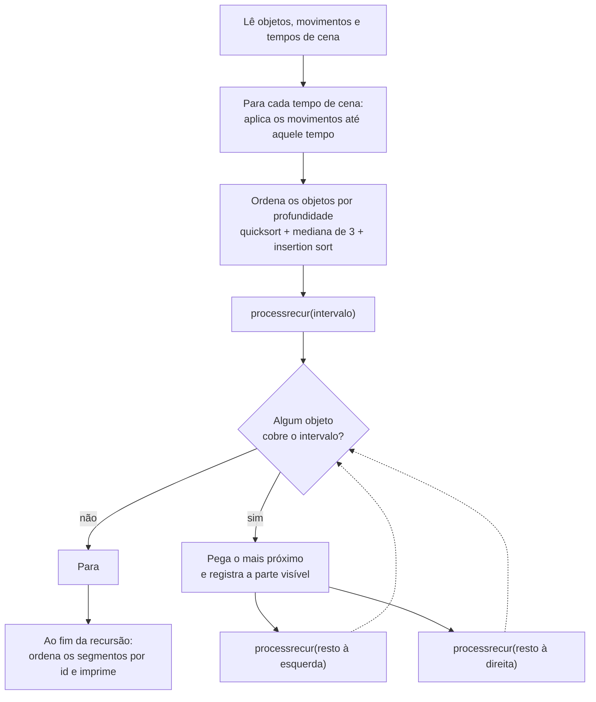

# Identificador de Objetos Oclusos

[English](README.md) | **Português**


Implementação em C++ de **remoção de objetos oclusos (*occlusion culling*) em cenas 2D**. Dado um conjunto de objetos em profundidades diferentes que se movem ao longo do tempo, o programa calcula quais partes de cada objeto realmente aparecem para quem vê a cena e descarta tudo o que fica escondido atrás de objetos mais próximos.

Trabalho prático da disciplina de Estruturas de Dados (Engenharia de Sistemas, Universidade Federal de Minas Gerais, 2025). O relatório completo, com a análise de complexidade e os experimentos, está em [`docs/relatorio_tp1.pdf`](docs/relatorio_tp1.pdf).

---

## Destaques

- **Tipos abstratos de dados próprios** (`Obj`, `Obj_List`, `Segment`, `Scene`, `interval`, `Move`), feitos do zero, sem os contêineres da STL, incluindo vetores dinâmicos com crescimento por duplicação.
- **Oclusão por divisão e conquista recursiva.** O algoritmo encontra o objeto mais próximo em um intervalo, guarda a parte visível dele e resolve recursivamente o que sobra à esquerda e à direita.
- **Ordenação implementada à mão.** Quicksort com pivô pela mediana de três, que passa para insertion sort em partições pequenas (n ≤ 10), além de busca binária e fusão de intervalos.
- **Análise de complexidade** de cada procedimento, com recorrências: O(n log n) na ordenação e O(n²) no pior caso para gerar a cena.
- **Estudo experimental** sobre quando reordenar uma cena em movimento. Permitir de 20% a 40% de desordem antes de reordenar reduziu o custo total em mais de 80% em relação a ordenar a cada movimento.

## O problema

Cada objeto é um segmento horizontal com centro `x`, largura e profundidade `y` (quanto menor o `y`, mais perto de quem vê). Os objetos se movem ao longo do tempo e, em instantes definidos, o programa precisa mostrar a parte visível de cada um. Uma parte de um objeto fica escondida sempre que um objeto mais próximo cobre o mesmo trecho horizontal.

```
 observador
   │
   ▼        ┌───── 1 (y=1) ─────┐
 y=1        0                   4
 y=2                  ┌────── 2 (y=2) ──────┐          → visível: [4, 7]
                      3                     7
 y=3                                            ┌─ 3 ─┐  → visível: [8, 10]
                                                8     10
```

## Como funciona



O objeto mais próximo em um intervalo é visível em toda a parte em que ele cobre esse intervalo, porque não há nada na frente dele ali. Todo o resto nesse trecho fica escondido, então o problema só continua à esquerda e à direita dele. As comparações de ponto flutuante usam tolerância de 1e-12.

| Procedimento | Tempo | Espaço |
|---|---|---|
| Busca binária em intervalos (`bisearch`) | O(log n) | O(1) |
| Quicksort com mediana de 3 | O(n log n) no caso médio | O(log n) |
| Partes visíveis de um objeto (`getvisible`) | O(n log n) | O(n) |
| Oclusão recursiva (`processrecur`) | O(n²) no pior caso | O(n) |
| Cena completa (`hiddenscene`) | O(n²) | O(n) |

## Resultados experimentais

O relatório mede um trade-off em cenas com movimento: reordenar os objetos a cada movimento deixa a geração da cena barata, mas custa caro por si só; deixar a ordem se degradar economiza ordenação, mas deixa a geração da cena mais lenta. O experimento variou o número de objetos (200 a 10.000), a velocidade dos movimentos e um limiar de desordem T que dispara a reordenação, com média de 10 execuções por configuração.

| Estratégia (N = 5.000, velocidade 10) | Custo total |
|---|---|
| Ordenar sempre (T = 0%) | 62,6 ms |
| Limiar T = 40% | 9,6 ms |

- Limiares entre 20% e 40% reduziram o custo total em mais de 80% em relação a ordenar sempre.
- A geração da cena ficou abaixo de 1 ms até a desordem passar de cerca de 20%.
- Com 10.000 objetos, ordenar sempre custou cerca de 124 ms, contra cerca de 54 ms com T = 20%.

## Entrada e saída

O programa lê da entrada padrão:

| Linha | Significado |
|---|---|
| `O <id> <x> <y> <largura>` | objeto centrado em `x`, na profundidade `y` |
| `M <tempo> <id> <x> <y>` | no `tempo`, o objeto `id` vai para (`x`, `y`) |
| `C <tempo>` | imprime a cena no `tempo` |

Para cada cena, imprime `S <tempo> <id> <início> <fim>` para cada segmento visível, ordenado pelo id do objeto. Exemplo ([`examples/01_movimento.in`](examples/01_movimento.in)):

```
O 1 2.0 1.0 4.0        S 0 1 0.00 4.00
O 2 5.0 2.0 4.0        S 0 2 4.00 7.00
O 3 9.0 3.0 2.0        S 0 3 8.00 10.00
C 0                    S 1 1 4.00 8.00
M 1 1 6.0 1.0          S 1 2 3.00 4.00
C 1                    S 1 3 8.00 10.00
```

## Como compilar e executar

Requer `g++` e `make`.

```bash
make                                   # gera bin/tp1.out
./bin/tp1.out < examples/01_movimento.in
make test                              # roda todos os exemplos e compara com a saída esperada
make interativo                        # versão interativa: digite as linhas e termine com FIM
```

O programa principal aceita até 200 objetos, 400 movimentos e 40 cenas por entrada.

## Estrutura do repositório

```
├── include/              # cabeçalhos: Objeto, Cena, Algoritmo
├── src/
│   ├── main.cpp          # lê a entrada padrão e imprime as cenas
│   ├── Algoritmo.cpp     # oclusão, ordenação e rotinas de intervalos
│   ├── Cena.cpp          # Scene e Segment
│   └── Objeto.cpp        # Obj e Obj_List
├── tools/
│   └── main_interativo.cpp
├── examples/             # entradas de exemplo (.in) e saídas esperadas (.out)
├── docs/
│   └── relatorio_tp1.pdf # relatório: método, complexidade e experimentos
├── Makefile
└── LICENSE               # GPL-3.0
```

## Autor

**Samuel Lima Horta**: [GitHub](https://github.com/samucao1803)

Engenharia de Sistemas, Universidade Federal de Minas Gerais (UFMG), Belo Horizonte, Brasil.

## Licença

[GNU GPL v3](LICENSE)
